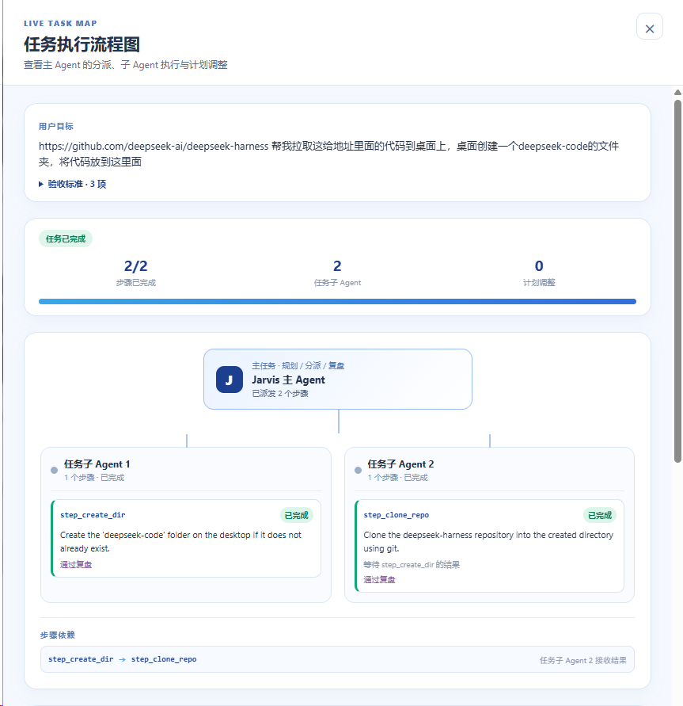
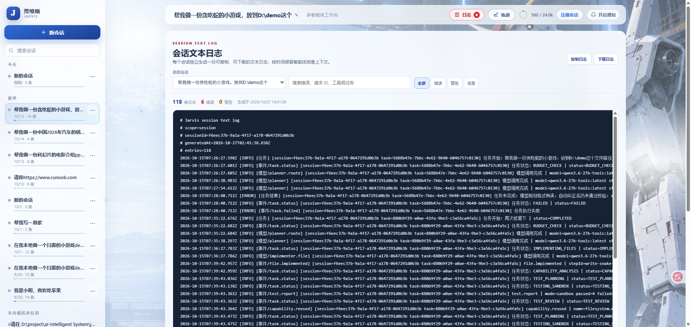
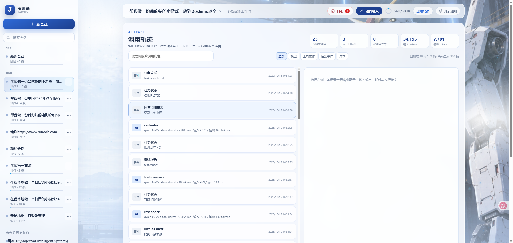

# 贾维斯 · ai-Intelligent System

**一个能规划、执行和验证任务的本地 AI Agent 工作台。**

用自然语言描述目标，贾维斯将任务拆成步骤、选择工具执行，并根据实际结果复盘。你可以在网页中跟踪进度、批准操作、查看执行证据，获得结构清晰的结果报告。

TypeScript · React · Fastify · SQLite · MCP


## 项目亮点

- **从目标到结果**：规划、工具执行、测试、评估与回答组成完整流程；每步执行后复盘，必要时调整后续计划。
- **按依赖协作**：主 Agent 分派任务步骤，工作子 Agent 通过本地消息共享已验证结果；流程图展示分工、依赖和执行状态。
- **工具按需扩展**：内置文件、文本、网络、进程与 PPT 生成工具；支持 MCP 工具发现与调用，也可为当前任务生成临时工具并进行沙箱测试。
- **操作权限可控**：提供“请求批准”“帮我批准”“完全访问权限”三种模式，默认在写入、联网和启动进程前请求批准。
- **执行过程可追踪**：会话、操作和模型调用记录保存在本地，可查看日志、调用轨迹、耗时与 token 用量；多会话管理与上下文压缩方便持续工作。
- **模型灵活接入**：支持本地 Ollama 和 DeepSeek 等兼容 OpenAI Chat Completions 的服务；工具任务按统一模板输出摘要、关键结果和限制说明。

当前工作子 Agent 共享同一执行循环，按步骤依赖推进。

## 界面预览

### 任务执行流程图

展开任务流程，一眼查看主 Agent 的分派、各步骤进度、验收标准与依赖关系。



### 会话日志

按会话搜索与筛选执行记录，查看错误、警告和任务事件，支持复制与下载。



### 模型调用轨迹

沿时间线查看模型请求与工具操作，统计调用次数、耗时和 token 用量，定位执行细节。



## 可以这样使用

```text
检查 E 盘哪个文件最大，告诉我完整路径和大小。
阅读工作区的 README，总结这个项目的主要功能。
把这个公开 Git 仓库克隆到指定目录。
根据这份提纲生成一份 PPT，保存到桌面。
```

具体操作受所选权限模式约束；执行结果与覆盖范围会在任务报告中说明。

## 快速开始

需要 **Node.js 24+** 和 npm。桌面应用相关能力面向 Windows。

### 1. 安装依赖

以下命令以 PowerShell 为例：

```powershell
git clone https://github.com/Kingdomest/ai-Intelligent-System.git
cd ai-Intelligent-System
npm ci
Copy-Item .env.example .env
```

### 2. 配置模型

编辑本地 `.env`，例如接入 DeepSeek：

```dotenv
MODEL_MODE=openai
MODEL_BASE_URL=https://api.deepseek.com
MODEL_NAME=deepseek-flash
MODEL_API_KEY=your_api_key_here
```

使用 **Ollama** 时，保留示例中的 `MODEL_MODE=ollama` 和本机服务地址，将 `MODEL_NAME` 改为已安装的模型名称，并启动 Ollama 服务。其他兼容接口按服务商提供的地址、模型名和密钥配置。修改 `.env` 后重启后端。

### 3. 启动项目

分别在两个终端执行：

```powershell
# 终端 1：后端 API
npm run dev
```

```powershell
# 终端 2：前端页面
npm run dev:web
```

打开 **http://127.0.0.1:5173**，新建会话即可开始。后端默认运行在 `http://127.0.0.1:3000`。

## 开发与扩展

```powershell
npm run typecheck          # TypeScript 类型检查
npm test -- --run          # 单元与集成测试
npm run build             # 类型检查并构建前端到 web/dist/
```

- [MCP 接入](docs/mcp.md)：扩展工具服务器，默认提供工作区只读文件系统与本地 Memory。
- [网络资料检索](docs/web-research.md)：新闻 RSS 与可选的 Brave Search 配置。
- [任务结果模板](docs/task-results.md)：统一报告结构与结果展示规则。
- [环境配置示例](.env.example)：工作区、数据目录、请求超时等选项。

## 本地数据与访问

会话和执行记录默认保存至 `data/jarvis.sqlite`；`.env`、`data/` 和日志已被 Git 忽略。使用远程模型时，请求内容会发送给所选模型服务商。

项目面向本地运行，默认仅监听 `127.0.0.1`。请将真实密钥保存在本地 `.env` 中；对外部署前需自行增加身份验证与访问控制。
