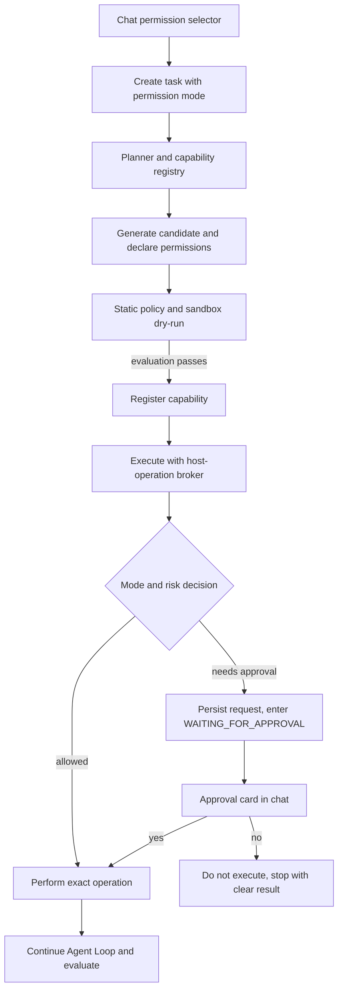

# Jarvis Permission Modes Design

## 1. Purpose and agreed requirements

Add task-scoped permission controls to the Jarvis chat so users can choose how the Harness handles operations that need access beyond read-only work.

The user-facing modes are:

| Mode | Required behavior |
| --- | --- |
| `request` / 请求批准 | Read-only work may proceed. Each privileged or state-changing operation pauses for a concrete user approval before it executes. |
| `auto` / 帮我批准 | The Harness automatically allows operations inside a defined low-risk boundary. Risky, irreversible, external, or uncertain operations pause for approval. |
| `full` / 完全访问权限 | Selecting this mode authorizes the task to use supported file, network, location, and process capabilities without per-operation prompts. It runs with the permissions of the Windows account hosting Jarvis. |

The composer shows a permission selector immediately to the right of “添加文件”, styled as a pop-up menu like the provided Codex reference. The selected mode is attached to each submitted task. The UI remembers the last selection locally; the backend stores the mode with the task so the mode is auditable and cannot change midway through a run.

When a task requests a path but the user says only “本地”, the default root is the current Jarvis project directory. A path outside that root is treated as outside-workspace access.

An approval is one-shot and bound to the exact operation shown on the approval card. It does not silently grant future operations or change the selected mode. “否” prevents the operation from executing; Jarvis reports that the task stopped or completed without that operation.

## 2. Existing system constraints

- Task status already includes `WAITING_FOR_APPROVAL`, but the current approval endpoint is a stub and is not wired to the Agent Loop.
- Capability manifests already list `filesystem.read`, `filesystem.write`, `network`, `location`, and `process` permissions.
- Generated tools currently must declare no permissions and are prompted to be pure read-only tools.
- Generated code runs in a temporary child-process directory which is deleted after each run. It has no supported bridge for durable host file operations.
- The current Agent Loop replaces a failed capability's specific error with a generic “没有可用能力” result.
- Task, event, capability, and retry state are stored in SQLite; existing databases need backward-compatible schema migration.

These constraints mean the feature must include backend policy enforcement, task persistence and resume behavior, a host-operation bridge, and the UI. A UI-only mode selector does not satisfy the requirement.

## 3. Selected architecture

Use a host-side Permission Broker between generated capabilities and actual privileged operations. A generated capability declares required permissions and calls a narrow typed runtime API; it cannot import arbitrary host APIs to bypass the broker. The broker receives the concrete operation and target, checks the task's selected mode and risk policy, and either executes it, records a pending approval and pauses, or rejects it.

Capability generation and evaluation stay separate from real effects. Candidate tools are statically checked and evaluated in the sandbox using a fake/dry-run host API. Only after evaluation passes can a capability be registered. During the actual task run, all host operations pass through the Permission Broker.

The broker is the enforcement point; an LLM risk opinion can inform the “帮我批准” decision but cannot override deterministic hard boundaries. Unknown permission types or operations fail closed by requesting approval, except in the explicitly selected `full` mode.

## 4. Mode policy and risk boundaries

### 请求批准

- Reads of task attachments and files within the project workspace may proceed.
- Reading paths outside the project workspace requires approval.
- Every write, overwrite, deletion, network request, location access, or process launch pauses before its side effect.
- The approval card identifies the exact operation, target, requested permission, and the reason the agent needs it.
- Approving executes only that operation. Denying performs no operation and ends or safely abandons the affected task branch with a clear user-visible explanation.

### 帮我批准

Automatically allow read-only work and non-destructive creation of new files or directories inside the current project workspace.

Require explicit approval for overwriting or deleting data, paths outside the workspace, network operations that transmit user or local-file content, location access, process launches, system configuration changes, and any operation the broker cannot classify confidently. The agent may classify intent and explain its reasoning, but the broker enforces these boundaries.

### 完全访问权限

Selecting `full` is the user's consent for this task to execute supported permission-bearing operations without per-operation approval. The broker executes requested operations using the permissions of the account running Jarvis. The UI clearly states that this can access arbitrary local paths and the internet and may launch processes. The mode is task-scoped; it does not silently enable full access for future tasks.

## 5. Operation and path contract

The runtime bridge exposes typed operations for the permissions already represented in capability manifests:

- `filesystem.read`: read an explicitly resolved path and return bounded content/metadata.
- `filesystem.write`: create or update a file or directory at an explicitly resolved path.
- `network`: make an explicitly described outbound request with bounded input/output.
- `location`: request location through a host adapter; if no adapter is configured, return a clear unsupported-capability result rather than pretending it ran.
- `process`: launch a described process with bounded arguments/time/output through the host adapter.

Every operation carries a stable operation ID, task ID, permission, action, target, and reason. The broker canonicalizes filesystem paths before applying mode rules. In `request` and `auto` modes, the default writable root is the current project directory. Path traversal and aliases are resolved before checking containment. In `full`, supported file operations may target paths outside the workspace.

The bridge returns structured results. File creation returns the actual resolved path; no tool may report success unless the host operation completed. Network, location, and process adapters report unsupported or execution failures distinctly from permission denial.

## 6. Approval state, persistence, and API

Add `permissionMode` to task creation input and persisted task records, with `request` as the default. Persist the current pending permission request with the task, including operation ID, action, target, requested permission, reason, risk assessment, and a resume token or equivalent checkpoint.

When the broker needs user approval:

1. Persist the pending operation and append a `task.permission_requested` event.
2. Set status to `WAITING_FOR_APPROVAL`; the loop does not invoke the operation while waiting.
3. Return the pending request in `GET /api/tasks/:taskId` so the chat renders it, including after a page reload.
4. Resolve the existing `POST /api/tasks/:taskId/approval` route with a matching request ID and boolean decision.
5. On approval, issue a one-shot grant for the exact pending operation, execute it once, record the decision and result, then continue the loop from the checkpoint.
6. On denial, clear the pending request, guarantee the operation was not invoked, record the denial, and return a clear cancelled/denied task result.

Reject stale, duplicate, mismatched, or already-resolved approval requests. Do not execute an operation twice if a client retries the approval request. Record mode selection, request, decision, execution, and outcome as task events without storing secrets or full sensitive payloads.

SQLite initialization migrates existing databases with a `request` mode and no pending request. Existing read-only tasks remain readable and do not require a reset.

## 7. UI behavior

- Add a permission button/menu next to “添加文件” in the composer, matching the reference layout and showing the active mode.
- Menu choices use the labels “请求批准”, “帮我批准”, and “完全访问权限”, with concise descriptions matching the policy above.
- Default to “请求批准”; remember the last selection in browser-local preferences and submit it with each task.
- Render a permission card in the chat stream when the task is waiting. Show operation, target path/domain/process, reason, and requested permission; provide “允许这次” and “拒绝” buttons.
- Disable duplicate decisions after the request is resolved and show the resulting task status.
- For `full`, display a clear description in the selector before the user submits a task; do not insert extra confirmation dialogs that contradict the selected mode.

## 8. Failure handling and auditability

- A denied operation must not be called and must never be converted to a successful task result.
- Preserve the concrete capability generation, policy, sandbox, and execution failure. Do not overwrite it with “没有可用能力”.
- If capability generation declares an unsupported permission or its code attempts to bypass the runtime bridge, reject the candidate before registration and record the reason.
- If the runtime process restarts while approval is pending, the request remains visible and no side effect is replayed automatically. A subsequent explicit decision may resume it; expired or invalid checkpoints fail safely with an actionable result.
- All permission decisions and privileged-operation outcomes are auditable from task events.

## 9. Acceptance criteria

1. Submitting a task stores the selected mode; omitted mode defaults to `request`.
2. The permission selector appears beside file upload, offers all three modes, and retains the user's last selection locally.
3. In `request`, a write operation pauses before side effects; approving runs that exact operation once and resumes; denying runs it zero times.
4. In `auto`, creating a new directory within the project workspace can proceed without a prompt, while overwrite/delete, outside-workspace access, sensitive outbound data, location, process, and uncertain actions wait for approval.
5. In `full`, a supported privileged operation executes without an approval card and remains limited to the current task's selection.
6. A request to create a folder named `hm` with no path creates it under the current project directory when allowed; the returned result names the actual path.
7. A permission request survives a page reload and remains bound to the correct task and operation ID.
8. Repeated/stale approval submissions cannot execute the operation more than once.
9. Candidate sandbox evaluation causes no real filesystem/network/process side effects; failed candidates are not published.
10. Capability failures retain their concrete reason rather than being overwritten with a generic missing-capability message.
11. SQLite data created by the current MVP opens with permission defaults without losing existing tasks or capabilities.
12. Every privileged attempt, approval or denial, and operation result is represented in the task event history.

## 10. Out of scope

- Adding operating-system adapters that are not available in the current runtime (such as location); unsupported operations must be surfaced explicitly.
- Cross-device authorization, team roles, or a centralized administrator policy.
- Persisting a blanket grant across tasks. The selector's remembered mode is a UI preference; each task stores its own consent snapshot.
- Replacing the current planner, evaluator, or Agent Loop with a different orchestration framework.
